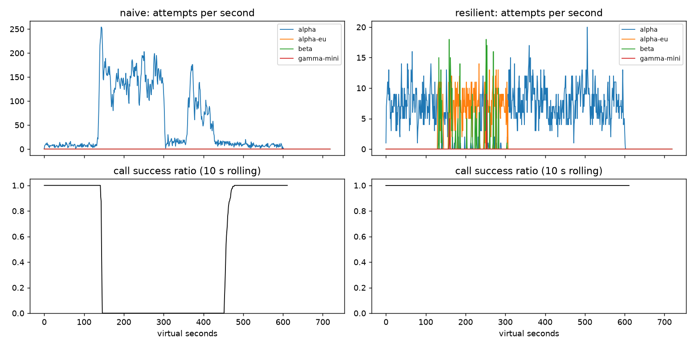

# Lab 25B: Report

**Họ tên / nhóm:** Đinh Đức Long (2A202602633)  
**Commit:** `a613e27d94f92dd175a78f3d83097654afd6eee1` (commit chứa code/config và kết quả kiểm tra)
 **Điểm tự động (`make grade`):** 84.0 / 88 
Ngày 13/10/2026, 82/82 test gốc và 18/18 kiểm tra biên bổ sung đều pass. Bộ chấm đạt mọi tiêu chí public trên seed 25, 26, 27. Máy Windows chưa có `make`, nên các lần kiểm tra dùng lệnh Python tương ứng trong Makefile.

Các bảng kết quả dùng seed mô phỏng 25 và seed jitter mặc định 1 của `build_client`. Số liệu nằm trong JSON/CSV tại `reports/gameday/`, `reports/cache/`, `reports/workflows.json`, `reports/slo.json` và `reports/scoreboard.json`.

## 1. Kết quả Game Day: client naive và client đã triển khai

| Băng | Client | availability | p95 (s) | amplification | retry_ratio | cost/turn | recovery (s) | PASS? |
|---|---|---:|---:|---:|---:|---:|---:|:---:|
| G1 | naive | 0.7194 | 7.157 | 7.738 | 6.738 | 2.163 | 4.0 | FAIL |
| G1 | yours | 1.0000 | 4.780 | 1.063 | 0.001 | 2.104 | 0.0 | PASS |
| G2 | naive | 0.4560 | 15.034 | 9.904 | 8.904 | 4.627 | 155.0 | FAIL |
| G2 | yours | 1.0000 | 9.847 | 1.037 | 0.005 | 2.105 | 0.0 | PASS |
| G3 | naive | 1.0000 | 4.768 | 1.164 | 0.164 | 2.328 | 0.0 | FAIL |
| G3 | yours | 1.0000 | 4.718 | 1.065 | 0.035 | 2.146 | 0.0 | PASS |
| G4 | naive | 1.0000 | 13.764 | 1.004 | 0.004 | 2.008 | 0.0 | FAIL |
| G4 | yours | 1.0000 | 5.684 | 1.013 | 0.002 | 2.069 | 0.0 | PASS |
| G5 | naive | 0.3699 | 5.359 | 17.030 | 16.030 | 2.124 | None | FAIL |
| G5 | yours | 0.8179 | 5.477 | 1.003 | 0.002 | 2.504 | None | PASS |
| G6 | naive | 0.5170 | 4.836 | 12.344 | 11.344 | 2.009 | 0.0 | FAIL |
| G6 | yours | 1.0000 | 6.099 | 1.053 | 0.017 | 2.202 | 0.0 | PASS |

## 2. Cấu hình client và lý do

| Tham số | Giá trị | Vì sao (dựa trên băng nào, số liệu nào) |
|---|---:|---|
| attempt_timeout_s | 8.0 | G6 đạt availability 1.0000; timeout 30s giảm còn 0.9488 với 107 GiveUp vì deadline. Giữ 8s dành thời gian cho failover trong deadline user 30s. G4 không suy giảm với 30s vì slow-call breaker còn hoạt động. |
| max_attempts_per_provider | 2 | Tối đa 1 lần retry trên cùng provider (2 attempts). Ở G2/G1, NaiveClient retry 36 lần gây bão retry (amplification 9.904). Giới hạn 2 attempts giúp giảm amplification xuống 1.037 ở G2. |
| backoff_base_s / cap_s | 0.25 / 4.0 | Ở G1/G2, full jitter từ 0.25s đến 4.0s tránh tình trạng thundering herd khi các client cùng retry tại một thời điểm, đồng thời fit vừa vặn trong turn deadline 30s. |
| retry_budget_ratio | 0.1 | Ở G3 (brown-out), alpha trả 500 cho 30% request. Naive có retry_ratio = 0.164 (vượt ngưỡng 0.10). Ratio 0.10 hạn chế retry chỉ chiếm $\le 10\%$ traffic, đưa retry_ratio của yours xuống 0.035. |
| breaker.window_size / min_calls | 20 / 10 | Cửa sổ nhỏ để phản ứng sớm sau khi đủ mẫu. G2 mặc định đạt amplification 1.037; vô hiệu breaker và tăng attempts lên 5 làm thành 1.378 dù vẫn giữ budget. Chưa đo riêng thời gian trip. |
| breaker.failure_rate_threshold | 0.5 | Trip khi $\ge 50\%$ request hỏng trong window. Ở G2 và G6, mở breaker nhanh chóng sau 10 calls lỗi, chuyển tải sang alpha-eu / beta, giữ availability đạt 100%. |
| breaker.slow_call_s | 5.0 | Ở G4, alpha không trả lỗi nhưng chậm thêm 5s (thời gian xử lý ~6.2s). Ngưỡng 5.0s giúp nhận diện đây là slow call để trip breaker kịp thời, kéo p95 từ 13.764s (naive) xuống 5.684s (yours). |
| breaker.open_duration_s | 10.0 | Tạm ngừng gửi rồi thăm dò lại; G2 đạt recovery 0s và primary_share_after_restore 1.0 với cấu hình phối hợp. Chưa tách riêng tác động của thời gian OPEN. |
| breaker.half_open_max_probes | 2 | Giới hạn tối đa 2 probes đồng thời. Cấu hình phối hợp đạt G2 recovery 0s, amplification 1.037; chưa thử riêng số probes. |

`min_time_left_s: 1` giúp bỏ qua attempt không còn đủ thời gian để chạy. `retry_budget_min_per_s: 0.5` cho phép một ít retry khi traffic thấp; `retry_budget_max_tokens: 20` giới hạn số token có thể tích lũy. Với ratio 0.1, thí nghiệm vô hiệu breaker trên G2 vẫn giữ retry_ratio ở 0.058, so với 0.378 khi budget gần như vô hạn.

`quota_cooldown_s: 300` ngăn gọi lại provider đang hết quota. G5 đạt availability 0.8179 và 0 client-error retries. `slow_rate_threshold: 0.6` cùng `half_open_successes: 2` được dùng với ngưỡng slow 5s và tối đa 2 probes; G4 có p95 5.684s, G2 có recovery 0s. Các kết quả này phản ánh cấu hình dùng chung, vì chưa làm thí nghiệm tách riêng từng tham số.

Sơ đồ quyết định của `on_error`:

```
                    ┌─────────────────────────┐
                    │      on_error(err)      │
                    └────────────┬────────────┘
                                 │
                     classify(err) -> ErrorKind
                                 │
     ┌───────────────────────────┼───────────────────────────┐
     │                           │                           │
[CLIENT_ERROR]           [QUOTA_EXHAUSTED]            [RATE_LIMITED]
  (400, 401)                   (429 quota)             (429 rps)
     │                           │                           │
breaker.release()         breaker.release()           breaker.release()
     │                           │                           │
GiveUp("client_error")    cooldown = 300s             cooldown = retry_after
(0 retry, 0 failover)     Failover ngay lập tức       Failover ngay lập tức
                                 │
                                 └──────────┬────────────────┘
                                            │
                           [OVERLOADED / SERVER_ERROR / TIMEOUT]
                                   (529, 503, 500, 0, 408)
                                            │
                                 counts_toward_breaker()
                                 breaker.on_failure()
                                            │
                           tries < max_attempts (2)
                           AND breaker != OPEN
                           AND fits deadline
                           AND budget.try_acquire_retry()?
                                     /             \
                                   YES              NO
                                  /                   \
                        Send(same_provider,      Failover sang provider
                         delay=jitter_delay)      tiếp theo trong ladder
```

## 3. Ba thí nghiệm

Các bảng dưới đây ghi lại kết quả thí nghiệm đã chạy. Mỗi biến thể chỉ thay cấu hình trong bộ nhớ; simulator, services, tests và scenarios giữ nguyên.

### 3.1. Retry budget khi breaker cấu hình sai

Để vô hiệu breaker, thí nghiệm đặt `breaker.min_calls: 1000000000` và `max_attempts_per_provider: 5`. Biến thể bật budget giữ cấu hình budget gốc. Biến thể tắt dùng ratio 100, max tokens 10^9 và min tokens/s 10^6.

| Băng | Budget | availability | amplification | retry_ratio | recovery (s) |
|---|---|---:|---:|---:|---:|
| G2 | bật | 0.9983 | 1.378 | 0.058 | 0.0 |
| G3 | bật | 1.0000 | 1.136 | 0.068 | 0.0 |
| G2 | tắt | 0.9754 | 1.580 | 0.378 | 24.0 |
| G3 | tắt | 1.0000 | 1.162 | 0.158 | 0.0 |

Khi breaker không ngắt, bật budget giảm retry_ratio G2 từ 0.378 xuống 0.058 và loại bỏ 24s chậm hồi phục. G3 hoàn thành mọi lượt ở cả hai biến thể, nhưng khi tắt budget, retry_ratio tăng từ 0.068 lên 0.158 và cost/turn tăng từ 2.271 lên 2.322.

Breaker cần đủ mẫu mới cách ly provider lỗi. Trong thời gian chờ đó, budget đã giới hạn retry; nó cũng bảo vệ khi nhiều provider cùng lỗi. Hai cơ chế vì vậy cần hoạt động cùng nhau. Amplification tính cả attempts failover, nên vẫn có thể vượt 1.1 dù budget đã giới hạn retry trên cùng provider.

### 3.2. Timeout 30s, đối chiếu G4 và G6

| Băng | Timeout | availability | p95 lượt thành công (s) | give_up_reasons |
|---|---:|---:|---:|---|
| G4 | 8s | 1.0000 | 5.684 | `{}` |
| G4 | 30s | 1.0000 | 5.608 | `{}` |
| G6 | 8s | 1.0000 | 6.099 | `{}` |
| G6 | 30s | 0.9488 | 5.362 | `deadline: 107`, `no_provider_available: 15` |

Trên G4, tăng timeout không làm kết quả xấu đi trong lần chạy này: slow-call breaker vẫn phát hiện response chậm và chuyển tải. G6 có provider bị treo. Timeout 30s dùng hết deadline của một số lượt, khiến client không còn thời gian failover.

P95 G6 giảm vì chỉ tính các lượt thành công; những lượt treo rồi thất bại không nằm trong mẫu. Do đó, cần đọc availability và give_up_reasons trước khi đánh giá p95. Timeout nên dựa trên độ trễ provider khi hoạt động bình thường, đồng thời chừa thời gian cho các bước còn lại và fallback trong deadline của user.

### 3.3. Bỏ lọc tool calling

Trong biến thể G6, `client.ladder = lambda task: list(client.order)` bỏ lọc tool calling trên đối tượng thí nghiệm. `incompatible_routes` tăng từ 0 lên 235; `give_up_reasons` ghi `incompatible_model_output: 235`. Availability giảm từ 1.0000 xuống 0.9015, còn cost/turn tăng từ 2.202 lên 2.284.

Về phía sản phẩm, khách không hoàn thành được tác vụ khi yêu cầu cần tool bị chuyển sang model không hỗ trợ tool, dù hệ thống vẫn tốn chi phí gọi model. Vì vậy, provider dự phòng phải đáp ứng được tác vụ khách đang thực hiện.

## 4. Workflow hoàn tiền

| Executor | completion | crashes | duplicate refunds | duplicate emails | lost refunds | overpaid (cents) | wasted LLM / crash | PASS? |
|---|---:|---:|---:|---:|---:|---:|---:|:---:|
| naive | 1.000 | 81 | 128 | 81 | 0 | 1,574,200 | 1.123 | FAIL |
| yours | 1.000 | 66 | 0 | 0 | 0 | 0 | 0.303 | PASS |

### Idempotency key và checkpoint

Idempotency key giúp payment gateway không hoàn tiền 2 lần cho cùng 1 key. Nếu worker crash sau khi thanh toán mà chưa có checkpoint, worker mới vẫn phải chạy lại từ bước 1 (`classify_request`, `lookup_order`). Việc này tốn thêm LLM token (`wasted_llm_per_crash` cao) và có thể làm payload thay đổi nếu dữ liệu đã khác.

Checkpoint cũng có khoảng trống: payment có thể đã chạy nhưng response bị mất, gây `ServiceTimeout`; worker cũng có thể chết sau khi gateway hoàn tiền và trước khi lưu checkpoint. Khi chạy lại `issue_refund`, thiếu idempotency key ổn định sẽ khiến gateway coi đó là giao dịch mới và hoàn tiền lần 2 (`duplicate refunds`).

Nếu ghi checkpoint thành công trước khi gọi `PaymentsAPI`, rồi worker chết hoặc payment thất bại vĩnh viễn, worker mới sẽ đọc checkpoint và bỏ qua bước thanh toán. Khách không nhận được tiền dù hệ thống ghi nhận đã hoàn (`lost refunds` > 0). Đây là lỗi hoàn tiền bị mất, nên checkpoint phải được ghi sau khi payment thành công.

## 5. Alerting & error budget

| Sự cố | Mong đợi | Naive alerter | Burn-rate alerter | Độ trễ phát hiện |
|---|---|---|---|---:|
| checkout_bug | page | page (delay 1m) | page | 27 min |
| provider_outage | page | page (delay 0m) | page | 4 min |
| deploy_blip | none | page (FALSE ALERT) | none | Không bị báo |
| slow_leak | ticket | none (BỎ SÓT) | ticket | 1337 min |
| degraded_evening | page | page (delay 214m) | page | 291 min |
| night_spike | none | page (FALSE ALERT) | none | Không bị báo |
| small_bump | none | page (FALSE ALERT) | none | Không bị báo |

### Error budget 30 ngày

Tổng lưu lượng là 25,901,755 requests. Với SLO 99.5%, ngân sách lỗi cho phép là 129,508.8 requests. Có 55,618 lỗi thực tế, tương ứng availability 99.7853%. Budget đã tiêu 42.95% và còn 57.05%, nên chưa cần đóng băng release (`freeze_releases: False`).

Với `small_bump`, 20 phút ở 12% lỗi lúc 11 giờ trưa không đủ điều kiện page. CSV ghi 1.794 lỗi trong 20 phút, bằng 1,385% ngân sách tháng. Cửa sổ ngắn có tỷ lệ lỗi cao, còn cửa sổ dài chưa đạt ngưỡng; điều kiện đa cửa sổ vì thế không kích hoạt. Đợt này tự hồi phục, nên việc không page giúp tránh mệt mỏi cảnh báo. Dữ liệu SLO hidden chưa có trong repo nên chưa kiểm chứng được.

## 6. Postmortem: băng G2 với client naive (blameless)



### Tóm tắt

Tại t=120s, alpha mất 75% năng lực phục vụ trong 180s, làm hàng đợi tích tụ và độ trễ tăng. Cơ chế retry cố định ở ba tầng, thiếu jitter, budget và breaker, tạo 34.475 attempts cho 3.481 logical calls, với amplification 9.904. Alpha khôi phục tại t=300s; client naive đạt tiêu chí recovery ở cửa sổ bắt đầu t=455s, chậm thêm 155s.

### Ảnh hưởng

Có 1.285/2.362 lượt thất bại, availability 45,60%; p95 của các lượt thành công là 15,034s. Từ lúc phát sinh sự cố đến mốc recovery là 335s. Giai đoạn đầu vẫn có completion thành công, nên khoảng này không thể được xem là thời gian mọi request đều thất bại.

Giả sử tháng chỉ có sự cố này, traffic đều 4 lượt user/s và SLO user-turn availability 99,5%. Trong tháng 30 ngày có 10.368.000 lượt, ngân sách cho phép 51.840 lượt lỗi. 1.285 lượt lỗi đã tiêu 2,479% budget, còn 97,521%, nên chưa cần freeze. Phép tính này dùng user turns; SLI ở mục 5 tính budget theo requests.

### Timeline từ CSV

Success ratio trong timeline được tính bằng `sum(calls_ok)/sum(calls_done)` trên 10 giây kết thúc tại t. `calls_ok` đếm logical LLM calls, không phải good user turns.

| t (s) | Sự kiện / quan sát | attempts_alpha/s | calls_ok/s | success ratio 10s |
|---:|---|---:|---:|---:|
| 119 | Trước sự cố | 9 | 7 | 100.00% |
| 120 | Alpha bắt đầu mất 75% năng lực | 5 | 7 | 100.00% |
| 136 | Retry tăng nhanh | 53 | 3 | 100.00% |
| 143 | Burst lớn, không có completion thành công trong giây này | 254 | 0 | 87.50% |
| 200 | Lỗi kéo dài, retry giữ tải cao | 135 | 0 | 0.00% |
| 300 | Alpha khôi phục năng lực; client vẫn lỗi | 115 | 0 | 0.00% |
| 350 | Attempts giảm nhưng completion vẫn thất bại | 17 | 0 | 0.00% |
| 452 | Chưa có completion thành công | 15 | 0 | 0.00% |
| 453 | Bắt đầu có completion thành công | 7 | 4 | 12.12% |
| 455 | Mốc recovery theo cửa sổ tiến 30s | 13 | 4 | 30.00% |
| 460 | Cửa sổ nhìn lùi tiếp tục cải thiện | 14 | 9 | 68.35% |

`recovery_s` dùng cửa sổ tiến `[s, s+30)`. Mốc t=455 được xác định theo cửa sổ này; tỷ lệ tức thời và cửa sổ nhìn lùi khi đó chưa đạt 95%. Trong `[455,485)`, có 352/368 calls thành công, tức 95,65%, đủ tiêu chí của grader.

### Trigger vs root cause

Trigger là alpha giảm 75% năng lực từ t=120 đến t=300. Root cause nằm ở chính sách retry: app, SDK và proxy cùng retry, tạo tối đa 36 attempts/call. Mỗi retry chờ cố định 0,2s, trong khi hệ thống thiếu jitter, budget và breaker.

Timeout 8s ở client không hủy công việc phía server. Provider vẫn xử lý các request mà người gọi đã bỏ, còn retry mới tiếp tục chiếm hàng đợi và đẩy tải vượt năng lực còn lại. Tải cao làm request chờ lâu hoặc lỗi; lỗi lại tạo thêm retry. Vòng lặp này duy trì sự cố sau khi hạ tầng phục hồi: tại t=300 vẫn có 115 attempts/s và 0 successful calls/s.

CSV không ghi queue depth. Phân tích hàng đợi vì vậy dựa thêm vào cơ chế simulator; một completion thành công chưa đủ chứng minh queue đã rỗng. Việc nhiều lớp tự retry cho thấy chính sách giữa các lớp chưa được phối hợp và khả năng quan sát còn thiếu. Kiểm thử cần theo dõi cả giai đoạn sau khi provider trở lại.

### Điều gì giúp / điều gì làm tệ hơn

Retry cố định nhiều tầng và việc server tiếp tục xử lý sau timeout làm sự cố kéo dài. Trên G2, ResilientClient dùng giới hạn attempts, budget, breaker và failover đạt availability 100%, amplification 1.037, recovery 0s và cost/turn 2.105; naive có cost/turn 4.627. Thí nghiệm ở mục 3.1 cũng cho thấy budget giảm thiệt hại khi breaker cấu hình sai.

### Action items

Các owner trong bảng là vai trò đề xuất nếu áp dụng vào hệ thống thực tế.

| # | Hành động | Loại | Owner | Cách kiểm chứng |
|---|---|---|---|---|
| 1 | Thống nhất một tầng retry, bật budget và breaker | prevent | Core Platform | CI G2 trên seed 25/26/27: amplification ≤ 1.2, availability ≥ 0.97, recovery ≤ 60s |
| 2 | Truyền deadline và hủy công việc quá hạn tới provider có hỗ trợ | mitigate | Backend Team | Kiểm thử tích hợp đo jobs còn chạy sau deadline, so trước/sau và kiểm tra recovery khi khôi phục capacity |
| 3 | Alert burn-rate, thêm attempts/call và upstream error rate | detect | SRE | SLI public 0 false page, checkout_bug ≤ 35m, provider_outage ≤ 8m; giữ các deadline này trong CI |
| 4 | Kiểm thử breaker cấu hình sai trước release | prevent | QA / Platform | G2/G3 ablation vẫn có retry_ratio ≤ 0.10 khi bật budget; review min_calls trước deploy |

## 7. Một điểm yếu còn lại

G2 có p95 9,847s dù availability đạt 100%, chậm hơn G1 4,780s và G3 4,718s. Khách vẫn phải chờ một attempt lỗi hoặc chậm trước khi client failover.

Hướng cải thiện là đo latency từng provider và queue wait, dùng các số đó để chọn timeout theo tác vụ rồi thử trên nhiều seed. Chỉ nên giữ thay đổi nếu p95 giảm mà availability, amplification và cost/turn vẫn đạt rubric. Bài hiện tại chưa triển khai điều chỉnh này.

## 8. Cache (Part G)

Số liệu từ `reports/cache/*.json`:

| Client | availability | faq_availability | cache_hit_ratio | stale_served | wrong_answers | outdated_answers | cost/turn | PASS? |
|---|---:|---:|---:|---:|---:|---:|---:|:---:|
| resilient (không cache) | 0.8373 | 0.8424 | 0.000 | 0 | 0 | 0 | 1.386 | FAIL |
| cached | 0.9124 | 0.9645 | 0.549 | 198 | 0 | 1 | 0.985 | PASS |

SemanticCache tìm theo cosine trong cùng prompt_version và không lookup/store câu cá nhân. Cache quản lý dung lượng bằng LRU, đồng thời invalidation theo source. Entry còn fresh khi tuổi ≤ TTL; sau đó chỉ được dùng nếu inner client GiveUp và tuổi chưa vượt TTL + max_stale_s.

Tại lúc GiveUp, client lookup lại để kiểm tra cả webhook có thể đã đến trong thời gian gọi provider. C1 đạt mọi tiêu chí trên seed 25, 26, 27.

| Tham số cache | Giá trị | Lý do gắn với kết quả |
|---|---:|---|
| similarity_threshold | 0.92 | Threshold 0.80 gây 111 wrong answers, toàn bộ other_question; 0.92 có 0 wrong answers và hit ratio 0.549. |
| ttl_s | 20 | TTL 20 có 1 outdated answer; TTL 30/60 có 2/3, còn TTL 300 có 95, vượt giới hạn 15. Giữ TTL 20 ưu tiên freshness và vẫn đạt hit ratio ≥ 0.50. |
| max_stale_s | 300 | Tắt stale có FAQ availability 0.8494; bật 300s có 198 stale served và FAQ availability 0.9645. Cửa sổ đủ bao phủ outage 120s. |
| max_entries | 500 | Giới hạn bộ nhớ bằng LRU; C1 có hit ratio 0.549 và 0 wrong answers. Chưa ablation riêng kích thước nên không kết luận 500 tối ưu. |

### 8.1. Ngưỡng similarity

| Threshold | cache_hit_ratio | wrong_answers | wrong_answers_by_reason | cost/turn |
|---:|---:|---:|---|---:|
| 0.80 | 0.560 | 111 | `{"other_question": 111}` | 1.022 |
| 0.92 | 0.549 | 0 | `{}` | 0.985 |
| 0.97 | 0.441 | 0 | `{}` | 1.058 |

Catalog có các intent gần nhau nhưng khác nghĩa, như refund_policy/refund_time và shipping_fee_city/shipping_fee_province. Centroid của các cặp near-miss có cosine 0.86. Với ngưỡng 0.80, metrics ghi 111 lỗi other_question. Metrics không ghi cặp câu cụ thể bị nhầm; các cặp nêu trên là ví dụ từ catalog.

Ngưỡng 0.97 bỏ lỡ nhiều paraphrase, khiến hit ratio còn 0.441, thấp hơn mức yêu cầu 0.50. Ngưỡng 0.92 đạt cả tính đúng của câu trả lời lẫn hit ratio.

### 8.2. TTL

| TTL (s) | cache_hit_ratio | outdated_answers | faq_availability | cost/turn |
|---:|---:|---:|---:|---:|
| 20 | 0.549 | 1 | 0.9645 | 0.985 |
| 30 | 0.592 | 2 | 0.9645 | 0.955 |
| 60 | 0.652 | 3 | 0.9645 | 0.915 |
| 300 | 0.731 | 95 | 0.9640 | 0.863 |

Webhook xóa cache khi chính sách hoàn tiền đổi tại t=150. Phí ship đổi tại t=480 lại không phát sự kiện, nên cache không nhận được thông báo source đã thay đổi. Khi hết TTL, entry không còn fresh và client phải gọi provider để lấy bản mới.

Tăng TTL giảm số calls, nhưng làm tăng câu lỗi thời. TTL 30/60 cũng đạt trên seed này; chọn 20 ưu tiên dữ liệu mới. Nếu provider đồng thời hỏng, stale-if-error có thể giữ câu cũ tới TTL + max_stale_s. Vì thế, TTL không bảo đảm loại bỏ hoàn toàn câu trả lời cũ trong outage.

### 8.3. Stale-if-error

| max_stale_s | faq_availability | cache_hit_ratio | stale_served | cost/turn |
|---:|---:|---:|---:|---:|
| 0 | 0.8494 | 0.434 | 0 | 1.067 |
| 300 | 0.9645 | 0.549 | 198 | 0.985 |

Khi tắt stale, client không dùng được entry hết TTL trong đợt mọi provider sập từ t=240 đến t=360. FAQ availability giảm 11,51 điểm phần trăm. Cửa sổ stale 300s phục vụ thêm 198 lượt. Câu cá nhân và entry đã bị webhook xóa vẫn không được phục vụ từ cache, nên FAQ availability chưa đạt 100%.

### Câu hỏi

Trạng thái đơn hàng và các câu hỏi cá nhân phụ thuộc từng user, đồng thời thay đổi liên tục. Cache theo user vẫn có thể trả trạng thái cũ, không đáp ứng yêu cầu lấy dữ liệu hiện tại. Với request.personal, client luôn gọi provider để giữ tính đúng và tránh lẫn dữ liệu giữa các user.

Trong lúc cache giữ availability ở tầng user, on-call vẫn cần theo dõi upstream error/timeout rate, breaker OPEN của từng provider và số hoặc tỷ lệ stale served. Failure rate của các tác vụ không cache được, như tool và câu cá nhân, cho biết phần user đang bị ảnh hưởng.

Cache hit hoặc HTTP 200 riêng lẻ chưa cho biết provider có hoạt động bình thường hay không. Các ngưỡng alert bổ sung cần được hiệu chỉnh theo baseline.

Sau audit, phép so sánh burn-rate tại ngưỡng inclusive dùng tolerance 1e-12 để bù sai số số thực. Error budget được tính bằng số chưa làm tròn. Cooldown không bị rút ngắn khi response khác đến sau, và quota được tách khỏi nhánh chờ rate-limit. Retry của call đang chạy cũng tôn trọng cooldown do call khác đặt.

Các ca kiểm tra biên bổ sung đã được chạy trước khi dọn các file kiểm tra tạm. Các tests được cung cấp giữ nguyên.

## 9. Trạng thái chuẩn bị nộp

Repo local nằm trên nhánh main, với origin `https://github.com/may31st/Track3-Day25-2A202602633-DinhDucLong.git`; tên repo khớp MSV và họ tên. REPORT, hình postmortem, JSON/CSV kết quả cùng scoreboard nằm trong reports và không bị Git bỏ qua.

Code/config, báo cáo và artifact đã được commit. Hash ở đầu báo cáo trỏ tới commit chứa phần triển khai và kết quả kiểm tra. Chưa xác minh quyền public của repo hoặc việc gửi link lên kênh lớp.

Trước khi nộp link, kiểm tra origin/main có đủ code và artifact, đồng thời thử mở repo khi không đăng nhập. Giữ lại artifact đã chuẩn bị, không chạy make clean.
